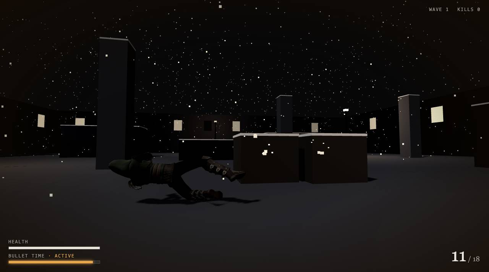
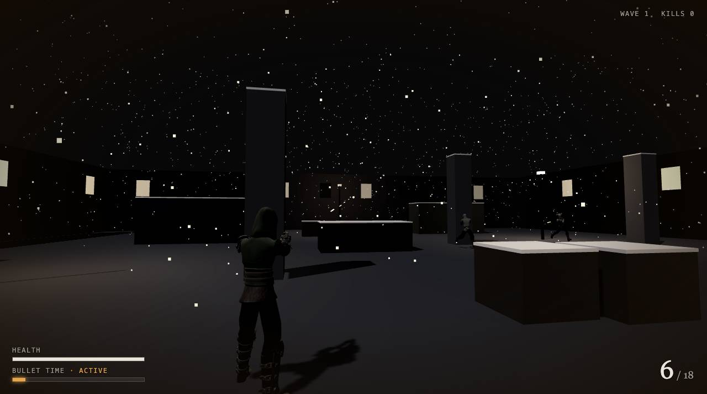

# Black Snow

A third-person bullet-time shooter that runs in the browser: a snowed-in back alley, a pistol, waves of gunmen, and the power to slow time when it all gets too fast.

Built with Next.js, React Three Fiber and three.js. No game engine, no plugins, no assets to install: open the page and play.





> **Status:** playable prototype. One arena, endless waves, desktop only (mouse and keyboard).

## Features

- **Bullet time.** Slow the world to a quarter speed while you still aim in real time. Enemy bullets become visible tracers you can step out of the way of. The meter drains while active and refills with kills.
- **Shootdodge.** Dive sideways in slow motion and keep firing. Lying flat in mid-air, you present a smaller target.
- **Over-the-shoulder camera** with mouse aim. It pulls in when a wall is behind you.
- **Enemy waves** that grow every round. Enemies close in, strafe, look for line of sight and shoot back.
- **Animated characters.** Legs and upper body animate separately: you can run one way while aiming another. Aim poses blend with pitch, and recoil, hit flinches and deaths are animated too.
- **Painkillers** dropped by enemies restore health.
- **Headshots** do triple damage.
- **Synthesised audio:** every sound is generated with the Web Audio API and drops in pitch during bullet time.

## Controls

| Input | Action |
|---|---|
| Mouse | Aim |
| W A S D | Move |
| Left click (hold) | Fire |
| Q or right click | Toggle bullet time |
| Shift or Space | Shootdodge (dive) |
| R | Reload |
| Esc | Pause |

Click the screen to start. The game captures the mouse pointer; press Esc to get it back.

## Getting started

Requires **Node.js 20.9 or newer**.

```bash
git clone https://github.com/Skye-Technology/black-snow-game.git
cd black-snow-game
npm install
npm run dev
```

Open http://localhost:3000.

| Script | What it does |
|---|---|
| `npm run dev` | Development server with hot reload |
| `npm run build` | Production build (the game is prerendered as a static page) |
| `npm start` | Serve the production build |
| `npm test` | Unit tests for collision and ray maths |
| `npm run import:characters` | Rebuild the character models (see below) |

## How it works

The simulation runs outside React. A single mutable `world` object (`src/game/world.ts`) holds the player, enemies, bullets and particles, and `src/game/simulation.ts` advances it once per frame. React components only *read* that state each frame to position meshes, so gameplay never triggers re-renders. The HUD is the one reactive part: a small zustand store that the simulation writes to only when a displayed value changes.

**Bullet time** is a time scale, not a physics trick. Every frame computes two deltas: one for the world (enemies, bullets, particles, snow, animations) and a less-slowed one for the player. That is why there is no physics engine: collision is a few dozen lines of ray-vs-box and capsule maths in `src/game/physics.ts`, covered by unit tests.

**Hit detection** treats every character as a capsule and every bullet as a segment travelling between frames, so fast bullets can't tunnel through bodies at low frame rates.

```
src/
├── app/                    Next.js page, layout, global styles
├── components/
│   ├── Game.tsx            Canvas, pointer lock, menus
│   ├── Hud.tsx             Health, ammo, bullet-time meter, hit markers
│   └── game/
│       ├── Scene.tsx       Lights, fog, and the per-frame simulation hook
│       ├── Level.tsx       Arena geometry, windows, street lamps
│       ├── Characters.tsx  Player, enemies and pickups
│       ├── AnimatedCharacter.tsx  Loads and clones a rigged model
│       ├── animator.ts     Layered animation (legs / upper body / additive)
│       └── Effects.tsx     Tracers, impact particles, muzzle flash, snow
└── game/
    ├── config.ts           Every tuning number in one place
    ├── level.ts            Arena layout and spawn points
    ├── simulation.ts       The game loop
    ├── physics.ts          Collision and ray maths (+ tests)
    ├── world.ts            Simulation state
    ├── store.ts            HUD state
    ├── input.ts            Keyboard and mouse
    └── audio.ts            Synthesised sound effects
```

### Tuning

All gameplay numbers live in [`src/game/config.ts`](src/game/config.ts): movement and dive speed, fire rate, damage, enemy accuracy and reaction times, bullet-time drain and refill, wave sizes. Change a value and the dev server reloads it.

The arena is defined as a list of boxes in [`src/game/level.ts`](src/game/level.ts). Every box blocks movement, bullets, line of sight and the camera.

### Debugging

In development builds, the live game state is available from the browser console:

```js
__game.world.player      // position, health, ammo…
__game.world.enemies     // every enemy and its AI state
```

This hook is stripped from production builds.

## Characters and animation

The character models are built from three free [Quaternius](https://quaternius.com) packs, all CC0:

- [Modular Character Outfits – Fantasy](https://quaternius.itch.io/modular-character-outfits-fantasy)
- [Universal Base Characters](https://quaternius.itch.io/universal-base-characters)
- [Universal Animation Library](https://quaternius.itch.io/universal-animation-library)

The built models are committed in `public/models/` (about 2.6 MB in total), so **you don't need the packs to run the game**. You only need them to change the characters.

To rebuild, download the **Standard** (free) zip of each pack into `~/Downloads` and run:

```bash
npm run import:characters
# or point it elsewhere:
npm run import:characters -- --from /path/to/zips
```

The script ([`scripts/import-characters.mjs`](scripts/import-characters.mjs)) needs no Blender: its tools (glTF Transform, meshoptimizer and sharp) are dev dependencies, installed by `npm install`. It also calls the system `unzip` command, which macOS and Linux include; on Windows, run it from WSL or Git Bash.

Every part in these packs is skinned to the same 65-bone skeleton, so the script:

1. Combines each outfit with a head (cut from the base body by bone weights), eyes, eyebrows and hair, re-binding every part to one skeleton by bone name.
2. Converts textures to WebP (1024 px colour, 512 px normal and ORM maps) and compresses meshes with meshopt. That takes the source files from about 300 MB down to 0.5–0.75 MB per character.
3. Writes a single shared `animations.glb` with only the clips the game uses. three.js binds animation tracks by bone name, so one animation file drives every character.

To change who appears in the game, edit the `CHARACTERS` list at the top of the script. Run `npm run import:characters -- --list-clips` to see all available animations.

## Deploying

The production build is a static page, so any static host works.

- **Vercel:** import the repository and keep the defaults. Every push to `main` deploys.
- **Other static hosts** (Netlify, Cloudflare Pages, GitHub Pages, S3): add `output: 'export'` to a `next.config.ts`, run `npm run build`, and upload the `out/` folder.

No environment variables or backend are needed.

## Known limitations

- Desktop only: the game needs pointer lock, a mouse and a keyboard.
- Enemies have no path-finding. They head for you and slide along cover, so they can get stuck on corners.
- One arena and endless waves; there is no story, campaign or saving.
- The character outfits are medieval-fantasy clothing, which doesn't quite match the noir setting yet.

## Credits

- Character models and animations: [Quaternius](https://quaternius.com), CC0 1.0.
- Built with [Next.js](https://nextjs.org), [React Three Fiber](https://r3f.docs.pmnd.rs) and [drei](https://drei.docs.pmnd.rs), [three.js](https://threejs.org) and [zustand](https://zustand.docs.pmnd.rs).
- Character pipeline: [glTF Transform](https://gltf-transform.dev), [meshoptimizer](https://github.com/zeux/meshoptimizer) and [sharp](https://sharp.pixelplumbing.com).

## License

The source code doesn't have an open-source license yet, so it is © Skye Technology, all rights reserved, until one is added. The character art in `public/models/` is CC0 and free to reuse.
